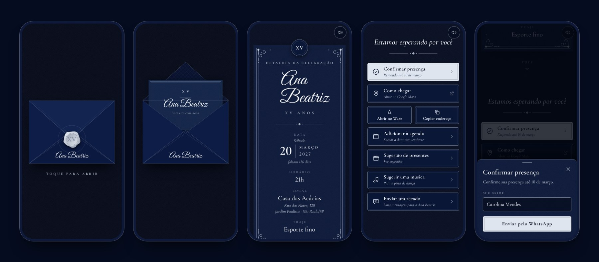

<div align="center">

# Convite digital de 15 anos

**Envelope interativo, mobile-first, feito só com HTML, CSS e JavaScript.**
Sem frameworks, sem build, sem dependências.




</div>

> **TL;DR (EN):** An interactive, mobile-first digital invitation for a 15th-birthday party, built with plain HTML, CSS and JavaScript. A wax-seal envelope opens in CSS 3D; guests RSVP through WhatsApp, add the party to their calendar (hand-written `.ics`), suggest a song, leave a message and read a guest manual. No frameworks, no build step, ~140 KB of code.

## O que é

Um convite pensado para ser **enviado por link no WhatsApp**. O convidado abre no celular, toca no lacre de cera e o envelope se abre. Depois vê os detalhes da festa e um menu com tudo que precisa fazer: confirmar presença, abrir o mapa, salvar na agenda, ver sugestões de presente, pedir uma música e deixar um recado.

<div align="center">


<sub>As imagens deste README usam dados fictícios.</sub>
</div>

## Funcionalidades

- **Abertura cinematográfica em CSS 3D**: o ambiente acende, um feixe de luz revela o envelope de cetim, um reflexo percorre o lacre prateado; ao toque, o lacre parte, a aba gira com sombra, o cartão sobe e se aproxima até virar a capa (~3 s, com botão **Pular**).
- **Direção de arte "Cetim e Prata"**: fundo de cetim azul-marinho com luz prateada, feixe diagonal e partículas lentas em `<canvas>`, hortênsias azuis, capa em arco com filete de prata e Manual do Convidado em cartão perolado.
- **Confirmar presença** pelo WhatsApp (`wa.me`) com mensagem pronta, nome e, se permitido, quantidade de pessoas.
- **Como chegar** pelo Google Maps ou pelo **Waze**, com botão de **copiar endereço**, e **adicionar à agenda**: arquivo `.ics` com lembrete 1 dia antes e link do Google Agenda.
- **Sugestão de presentes** em grupos, **sugerir música** e **enviar recado**, ambos pelo WhatsApp.
- **Manual do Convidado** (com amostras das cores a evitar), prazo de confirmação e **contagem regressiva** discreta.
- **Música de fundo** com botão de silenciar (começa só depois do toque, como exigem os navegadores).
- **Tudo configurável** em um único objeto `CONFIG` no topo de [`assets/js/app.js`](assets/js/app.js).

## Destaques técnicos

| Desafio | Como foi resolvido |
|---|---|
| Envelope realista sem biblioteca | Camadas SVG que compartilham o mesmo `viewBox`; a aba gira com `perspective` + `rotateX` e troca de `z-index` no meio da rotação, passando para trás do cartão. O forro usa `rotateY(180deg)` para o vértice continuar apontando para cima. |
| Lacre que quebra | Uma arte SVG usada em duas metades recortadas por um mesmo `clip-path` em zigue-zague; lascas criadas em JS com variáveis CSS (`--dx`, `--dy`, `--r`). |
| Compatibilidade com iPhones antigos | Sem `aspect-ratio` nem *container queries*: proporção por "truque do padding" e medidas por uma variável CSS (`--env-w`). |
| Agenda em qualquer fuso | `.ics` (RFC 5545) escrito à mão: horário em UTC, escape de vírgulas e quebras, dobra de linhas em 75 **bytes** UTF-8 sem cortar acentos, `VALARM` de 1 dia. |
| Contagem certa em qualquer fuso | Os dias são contados entre a data de hoje **no fuso do evento** (UTC-3) e a data da festa, então um celular em outro fuso não erra o dia. Depois da festa, a linha vira um agradecimento. |
| Mensagens do WhatsApp | Modelos com `{chaves}`; linhas cujo campo ficou vazio somem sozinhas. Trava contra toque duplo e link de reserva se o app não abrir. |
| Teclado do celular | Janelas ajustadas por `visualViewport` (iOS e Android), campos com fonte ≥ 16 px (evita zoom do iOS) e `:active` habilitado no Safari do iPhone (truque do `touchstart`). |
| Acessibilidade | Foco devolvido ao botão de origem, `Esc` fecha, `inert` no fundo, alvos ≥ 48 px, `prefers-reduced-motion`, rótulos e contraste. Lighthouse: **Acessibilidade 100 · Boas práticas 100**. |
| Segurança | Conteúdo sempre via `textContent` (nunca `innerHTML`), `Content-Security-Policy`, `rel="noopener"`, sem *trackers*, `noindex` (convite particular). |
| Música original | [`tools/make_music.py`](tools/make_music.py) sintetiza a valsa (piano aditivo, piano elétrico FM, cordas, reverb por convolução) e fecha o loop somando a cauda do reverb ao início. Saída determinística. |

## Decisões e trade-offs

Medi antes de "otimizar":

- **Fontes sem bloquear a renderização.** Testei carregar o CSS do Google Fonts por JavaScript. Com o Google simulado lento (6 s), a página passou a abrir em ~70 ms em vez de esperar, mas no caso normal o Lighthouse oscilou demais no meu ambiente (a mesma versão ia de 76 a 98) para provar ganho. Como o método padrão tem menos código, mantive o padrão.
- **Bug achado pelos testes:** o *fade-in* do volume podia calcular um valor levemente negativo; o navegador recusava e o fade parava no meio, deixando a música **muda**. Agora o volume é limitado a 0–1.
- **Medições de desempenho variam** com a latência do Google Fonts. Por isso o README não cita uma nota de desempenho: o site tem ~140 KB de código, ~150 KB de imagens e a música (~1 MB).

## Estrutura

```
.
├── index.html            estrutura, sprite SVG (ícones, lacre, ornamentos) e janelas
├── assets/
│   ├── css/style.css     visual: variáveis, envelope 3D, lacre, moldura, botões, janelas
│   ├── js/app.js         CONFIG (dados e textos) + lógica: envelope, música, agenda, WhatsApp, formulários
│   ├── img/flores/       hortênsias (WebP com transparência)
│   ├── img/fundo/        textura de cetim do fundo
│   ├── img/              favicon, ícone do iPhone, imagem de prévia do link
│   └── musica.mp3        trilha de fundo (instrumental, gerada por código)
├── tools/                geradores: trilha (make_music2.py), hortênsias (make_flores.js), cetim (make_cetim.py)
├── docs/                 imagens deste README
└── _headers              cabeçalhos de segurança (Netlify)
```

## Personalizar

Tudo que muda de um convite para outro está no `CONFIG`:

```js
const CONFIG = {
  pessoa: { nome: "Ana Beatriz", primeiroNome: "Ana", sobrenome: "Beatriz", xv: "XV", titulo: "XV Anos" },
  evento: { data: "2027-03-20", hora: "21:00", fusoHorario: "-03:00", traje: "Esporte fino" },
  local:  { nome: "Casa das Acácias", rua: "Rua das Flores, 120", bairro: "Jardim Paulista", cidade: "São Paulo/SP" },
  whatsapp: "11999990000",                   // DDD + número
  rsvp: { maxPessoas: 1, prazo: "2027-03-10" },   // 1 = convite individual
  contagem: { mostrar: true, varios: "faltam {n} dias" },
  // presentes, manual, mensagens do WhatsApp, textos da interface...
};
```

O dia da semana e o horário são calculados a partir de `data` e `hora`. Para trocar a música, substitua `assets/musica.mp3`. Se mudar nome ou data, ajuste também `<title>` e as tags `og:` do `index.html`.

## Rodar localmente

Não há dependências nem etapa de build:

```bash
python3 -m http.server 8000
# abra http://localhost:8000
```

## Publicar

É um site estático: funciona no **Netlify** (importando este repositório, sem comando de build) ou no **GitHub Pages** (*Settings → Pages → Deploy from a branch → main / root*). Para a pré-visualização do link no WhatsApp, troque `og:image` no `index.html` pelo endereço completo da imagem.

## Qualidade

Verificado com Playwright (Chromium) em telas de 320 a 844 px: sem rolagem horizontal, alvos de toque ≥ 48 px, 40 verificações de fluxo (formulários, links do WhatsApp e do Waze, copiar endereço, `.ics`, janelas e tecla `Esc`), a contagem regressiva com datas simuladas (inclui fuso e depois da festa) e casos de borda (política de segurança ativa, fontes bloqueadas, JavaScript desligado).

**Limitações conhecidas:** testado em Chromium emulado, não em iPhone/Safari reais; o download do `.ics` pode variar em navegadores embutidos de apps (o link do Google Agenda serve de alternativa); a música é um *placeholder* original e o Google Fonts é a única dependência externa.

## Licença

[MIT](LICENSE). Fontes: Cormorant Garamond, Pinyon Script e Jost (SIL OFL), servidas pelo Google Fonts.
